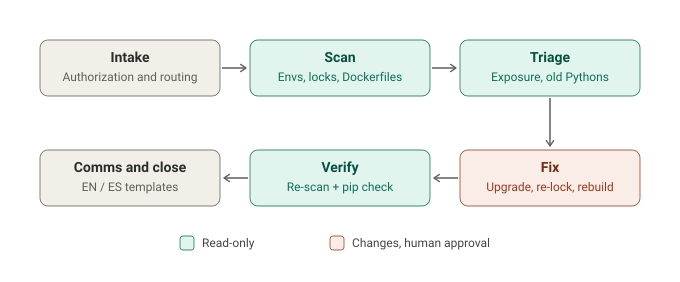

# python-vuln-responder

Find and fix every Python environment, lockfile and Docker image that still carries a
vulnerable PyPI package, with AI agents doing the legwork and a human approving every
change. First advisory: **Pillow < 13.0.0** (October 2026).

> Pillow 13.0.0 fixes about 40 security issues, two rated critical: stale image storage
> after mode changes and JPEG decoder overflows, plus EPS filename injection into
> Ghostscript (command execution) and lossless-JPEG / in-memory TIFF overflows with a
> public proof of concept. Opening or saving a crafted image is enough.
> ([release notes](https://pillow.readthedocs.io/en/stable/releasenotes/13.0.0.html),
> [The Hacker News](https://thehackernews.com/2026/10/critical-flaw-in-pythons-popular-pillow.html))



## The catch: Python 3.10

| | Status | What to do |
|---|---|---|
| **Pillow < 13.0.0** on Python >= 3.11 | **AFFECTED** | `pip install --upgrade "pillow>=13.0.0"`, re-lock |
| **Pillow < 13.0.0** on Python 3.10 or older | **BLOCKED**: 13.0.0 needs Python >= 3.11, no 12.x backport | Move to Python 3.11+ (3.10 reaches end of life in October 2026); interim mitigations meanwhile |
| `requires-python >=3.10` / `FROM python:3.10` with Pillow | **BLOCKED** | Raise the floor, rebuild the image |
| Ghostscript installed | Risk | EPS command-injection path is reachable |
| `olefile` installed | Risk | FlashPix decoding path is enabled |

## What the scanner does

```bash
python3 scripts/pyvuln-scan.py --local --venvs ~/code --project ~/code -o pyvuln
```

- **Finds every Python:** system, python.org, Homebrew, pyenv, conda, uv-managed,
  mise/asdf, Windows `py` launcher, plus every virtualenv and conda env under your folders.
- **Reads installed versions safely:** the probe inside each interpreter only reads
  package metadata; it never imports third-party code.
- **Projects:** requirements and `.in` files, `pyproject.toml` (PEP 621, Poetry carets,
  `requires-python`), uv / poetry / pdm / pylock / Pipfile locks, conda
  `environment.yml`, Dockerfiles (base image Python and pins), and code that imports
  the package, with hints for risky calls (`thumbnail()`/`draft()`, EPS, TIFF to memory).
- **Advisory-driven:** each `advisories/*.env` describes one package. Add a file and the
  same scanner covers the next PyPI incident.
- **Optional `--osv`:** checks every other installed package against OSV.dev (sends
  only names and versions).
- **Fix plan:** exact upgrade commands per environment, a checklist per project,
  BLOCKED upgrade paths and mitigations.

Outputs: `.html` (color report), `.csv`, `-fix-plan.md`. Python 3.8+, standard library
only, Linux / macOS / Windows (`py -3 pyvuln-scan.py ...`).

## What's inside

| | |
|---|---|
| **Scanner** | `scripts/pyvuln-scan.py` |
| **Skills** | `pyvr-navigator` (start here), `pyvr-scan`, `pyvr-fix` (+ playbooks), `pyvr-verify-close`, `pyvr-comms` (EN/ES), `pyvr-advisory-update` |
| **Claude Code** | `/pyvr`, `/pyvr-scan`, `/pyvr-fix`, `/pyvr-verify`; `pyvr-verifier` agent; a hook that **asks before every install, re-lock or rebuild** and blocks disabling TLS verification or fetching exploit files |
| **Advisory** | `advisories/pillow-2026-10.env`: range, fix, minimum Python, risk factors, code hints, mitigations, IDs |

## Install

```bash
# Claude Code (full plugin)
/plugin marketplace add luivc1/python-vuln-responder
/plugin install python-vuln-responder@python-vuln-responder

# Hermes, or any Agent Skills folder
./install.sh --target hermes
./install.sh --dest /path/to/skills
```

Other agents: point them at [`AGENTS.md`](AGENTS.md). Or ask: *"Are my Python apps
affected by the Pillow vulnerability?"* / *"¿Mis apps de Python están afectadas por la
vulnerabilidad de Pillow?"*

## Safety

- The scanner is read-only; every install, re-lock or rebuild is approved one step at a time.
- Fixes are verified by version, never with exploit code or crafted images.
- Only scan systems you own or are authorized to manage.

Related: if a scan warns that pip is older than 26.2.2, upgrade it safely first with
[python-cert-responder](https://github.com/luivc1/python-cert-responder). Siblings:
[php-vuln-responder](https://github.com/luivc1/php-vuln-responder) ·
[node-vuln-responder](https://github.com/luivc1/node-vuln-responder) ·
[railway-secrets-responder](https://github.com/luivc1/railway-secrets-responder)

## License

[MIT](LICENSE) © 2026 Innovatask LLC
